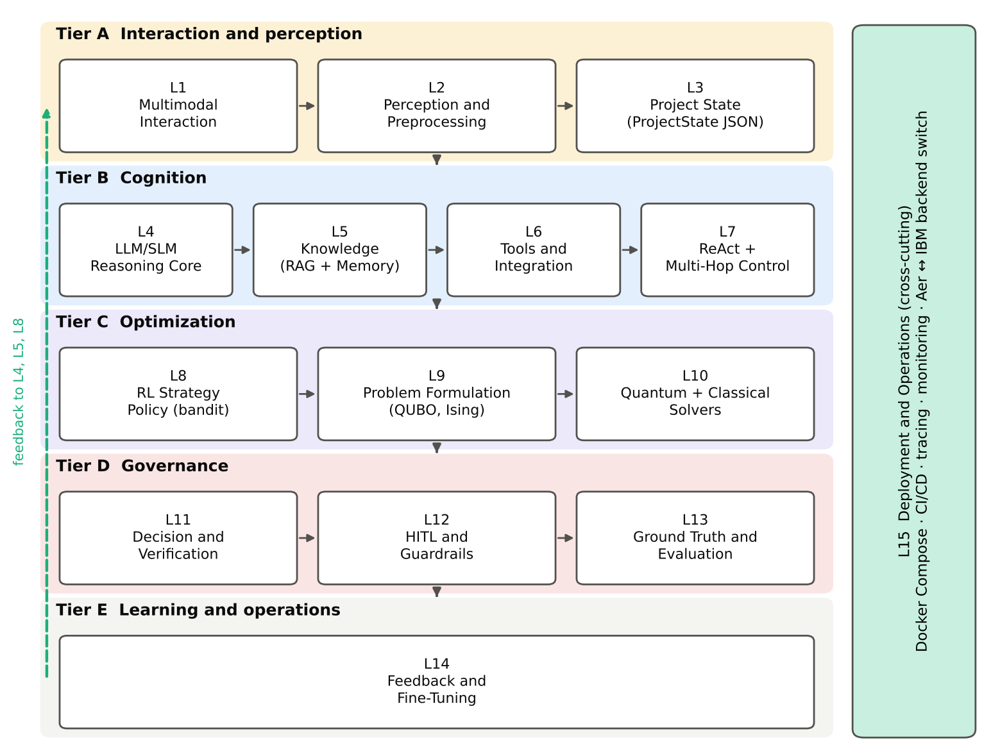
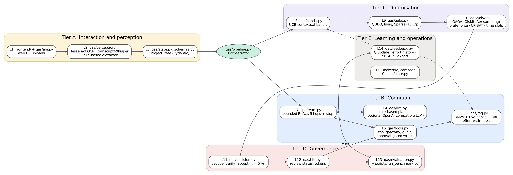
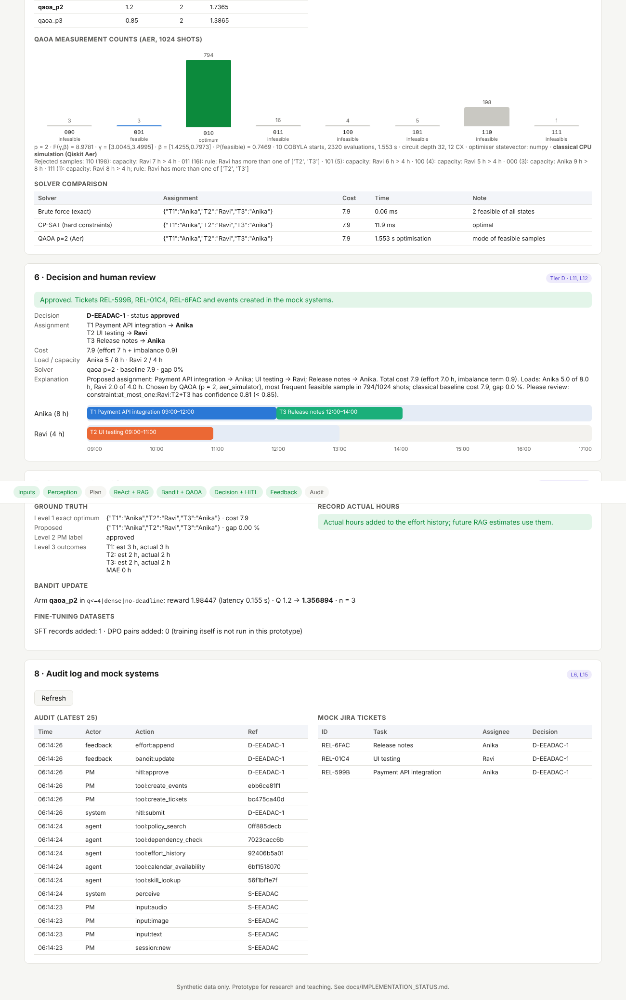

# Quantum-Enhanced Agentic AI for Intelligent Task Planning and Optimization

A working prototype of an agentic AI scheduling assistant. A project manager gives it a
typed brief, a photo of the team's task board and a voice note (or transcript). The
agent reads the inputs, gathers missing facts through tool calls and retrieval, picks
a solving strategy with a contextual bandit, writes task allocation as a QUBO, solves
it with **QAOA on the Qiskit Aer simulator**, checks the answer against an exact
classical solver, builds a timetable and waits for human approval before creating
tickets. Approved outcomes feed back into retrieval and the bandit.

The project implements the 15-layer, 5-tier architecture from the accompanying
course report ([docs/assignment_report.pdf](docs/assignment_report.pdf)).

> **Honest scope.** Quantum circuits run as a classical simulation (Qiskit Aer on a CPU).
> No quantum hardware was used and no quantum advantage is claimed; on these problem
> sizes CP-SAT is faster and exact. The LLM planner and the speech-to-text model are
> optional; the default path is deterministic and offline. All data are synthetic.
> See [docs/IMPLEMENTATION_STATUS.md](docs/IMPLEMENTATION_STATUS.md) for what is
> implemented, simplified, simulated or future work.



## What it does, layer by layer

| Tier | Layer | Module | Status |
|---|---|---|---|
| A | L1 Multimodal interaction | `frontend/`, `qas/api.py` | Implemented (simplified UI) |
| A | L2 Perception: vision, audio, text | `qas/perception/` | Tesseract OCR implemented; transcript or optional Whisper; rule-based extractor |
| A | L3 Project state | `qas/state.py`, `qas/schemas.py` | Implemented |
| B | L4 LLM/SLM reasoning | `qas/llm.py` | Rule-based planner by default; optional OpenAI-compatible LLM (untested) |
| B | L5 RAG + memory | `qas/rag.py` | BM25 + LSA dense retrieval + RRF; effort estimates |
| B | L6 Tools | `qas/tools.py` | Gateway, audit log, approval-gated writes, mock Jira/calendar |
| B | L7 ReAct + multi-hop | `qas/react.py` | Implemented |
| C | L8 RL strategy | `qas/bandit.py` | UCB contextual bandit |
| C | L9 Formulation | `qas/qubo.py` | QUBO, Ising, Qiskit `SparsePauliOp` |
| C | L10 Solvers | `qas/solvers/` | QAOA (Qiskit, sampled on Aer), brute force, CP-SAT, CP-SAT timetable |
| D | L11 Decision | `qas/decision.py` | Independent feasibility check, 5 % acceptance rule, fallback |
| D | L12 HITL | `qas/hitl.py` | Flagged/standard review, acknowledgement, edit re-verification, tokens |
| D | L13 Ground truth + evaluation | `qas/evaluation.py`, `scripts/run_benchmark.py` | Implemented on synthetic cases |
| E | L14 Feedback + fine-tuning | `qas/feedback.py` | Q update, effort history, SFT/DPO export; training not run |
| E | L15 Deployment | `Dockerfile`, `docker-compose.yml`, CI | Single-container deployment |



## Quick start

```bash
pip install -r requirements.txt          # Python 3.10+; also install the Tesseract binary (see docs/DEPLOYMENT.md)
uvicorn qas.api:app --port 8000          # open http://localhost:8000
```

In the UI: **Load demo scenario** → **Run agent** → tick the flag → **Approve** → **Record outcomes**.

Command line instead of the UI:

```bash
python scripts/run_demo.py               # whole scenario through all layers
python scripts/run_demo.py --noisy       # also sample with an illustrative noise model
pytest -q                                # 27 tests
python scripts/run_benchmark.py          # 30 synthetic cases → benchmarks/RESULTS.md
```

Docker: `docker compose up --build` (see [docs/DEPLOYMENT.md](docs/DEPLOYMENT.md)).

## The worked scenario

Meera (PM) types *"Plan Thursday's release tasks for Anika and Ravi, keep the load fair."*,
uploads a board with three To Do notes (Payment API integration, UI testing, Release notes)
and one Done note, and says *"Ravi's on half-day leave Thursday, so he can take at most one
of the UI testing and release notes."*

| Step | Output produced by the code |
|---|---|
| OCR (L2) | 4 notes read, confidences 0.94 to 0.96; "Login bug fix" excluded (Done column) |
| Transcript (L2) | Ravi 4 h (0.88); rule "Ravi at most one of T2, T3" (0.81) |
| ReAct (L7) | skill_lookup → calendar_availability → effort_history → dependency_check → policy_search → stop |
| RAG (L5) | cost table Anika 3/4/2 h, Ravi 5/2/1 h (similarity-weighted past tasks) |
| Bandit (L8) | UCB scores 1.610 / 1.737 / 1.387 → QAOA p = 2 |
| QUBO (L9) | C(x) = 17.1 − 6x₁ − 9.2x₂ − 5.5x₃ + 9.6x₁x₂ + 4.8x₁x₃ + 13.6x₂x₃ |
| Ising (L9) | H = 13.75 − 0.6Z₁ − 1.2Z₂ − 1.85Z₃ + 2.4Z₁Z₂ + 1.2Z₁Z₃ + 3.4Z₂Z₃ |
| QAOA (L10) | p = 2 on Aer, 1024 shots: 010 measured about 790 times |
| Decision (L11) | 110 (198 shots) rejected for Ravi's capacity; 010 accepted, cost 7.9, gap 0 % against CP-SAT |
| Timetable (L10) | Anika T1 09:00 to 12:00, T3 12:00 to 14:00; Ravi T2 09:00 to 11:00 |
| HITL (L12) | flagged review because of the 0.81 constraint; approve creates 3 tickets + 3 events |
| Feedback (L13, L14) | exact optimum matches; actual hours give MAE 0.37 h; Q(p = 2) updated |

The QUBO, Ising coefficients, enumeration, timetable and bandit scores match the report
exactly and are asserted in `tests/`. Exact counts vary slightly with the optimiser's random restarts.



## Benchmark (synthetic, measured)

`scripts/run_benchmark.py` generates 30 seeded cases (20 with two people, binary encoding;
10 with three people, one-hot encoding), renders each board image, runs perception and the
agent, and solves every case with QAOA at p = 1, 2 and 3 plus CP-SAT and brute force.
The full table is in [benchmarks/RESULTS.md](benchmarks/RESULTS.md); raw rows are in
`benchmarks/results/benchmark.json`.

Headline results from the last run (30 cases, 6 COBYLA restarts, 1024 shots, seed 2026):

| Measure | Result |
|---|---|
| Extraction F1 (OCR + transcript + brief vs gold) | 1.000 on all 30 cases (clean rendered boards, so this is an easy setting) |
| Cases with a feasible plan | 25 of 30; the other 5 are infeasible by construction and the agent correctly returns no plan |
| CP-SAT gap to the exact optimum | 0 % in every case |
| Proposals that broke a hard constraint | 0 of 75 |
| QAOA accepted (within 5 % of optimum), 2 people, binary encoding | 41 of 45 runs; mean P(optimal) 0.446 |
| QAOA accepted, 3 people, one-hot encoding (9 to 12 qubits) | 5 of 30 runs; mean P(optimal) 0.003, so the classical fallback was used |
| Mean P(optimal) by depth p = 1 / 2 / 3 | 0.201 / 0.274 / 0.332 |

The one-hot result is the important negative finding: with the standard X mixer and
penalty-based one-hot constraints, shallow QAOA rarely samples a feasible assignment,
and the decision layer falls back to CP-SAT. This matches the limitation discussed in
Section 15.1 of the report (constraint-preserving mixers are future work).

## Repository layout

```
qas/                 Python package, one module per layer (see table above)
  perception/        L2 vision (Tesseract), audio (transcript / faster-whisper), text extraction
  solvers/           L10 QAOA (Qiskit + Aer) and classical solvers (brute force, CP-SAT)
frontend/            single-page UI (HTML, CSS, JS; no build step)
data/                synthetic org data, RAG corpus, effort history, demo inputs
scripts/             run_demo.py, run_benchmark.py, generate_demo_assets.py, finetune_slm.py (template)
tests/               pytest suite (27 tests)
benchmarks/          generated benchmark results
docs/                report PDF, figures, implementation status, deployment notes, screenshots
```

## Technology

Python 3.12 · Qiskit 2.6 · Qiskit Aer 0.18 · qiskit-optimization 0.7 · OR-Tools CP-SAT ·
SciPy COBYLA · scikit-learn · FastAPI · Pydantic · Tesseract OCR · vanilla JS.

## Citation

If you use this code, please cite the accompanying report:
*Sai Deekshith, "Quantum-Enhanced Agentic AI for Intelligent Task Planning and Optimization:
A Multimodal, Human-in-the-Loop Architecture with QAOA-Based Task Allocation", Advanced AI
course assignment, Rajiv Gandhi Institute of Petroleum Technology, 2026.*

## Licence

MIT. All data in `data/` are synthetic.
